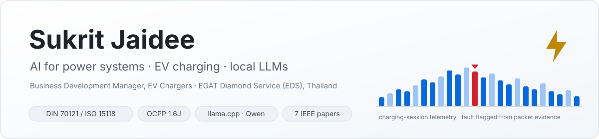
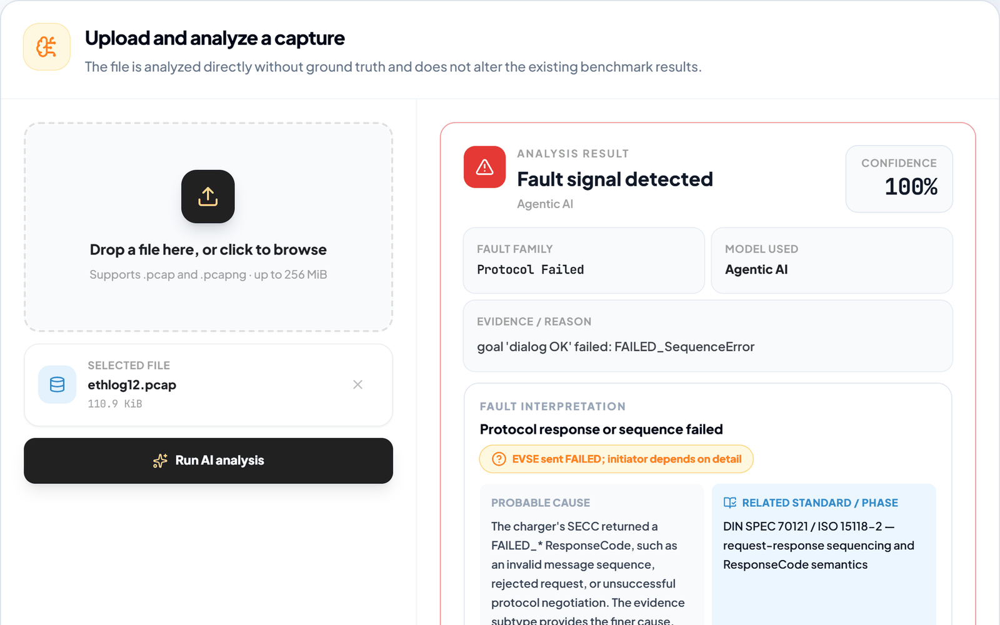
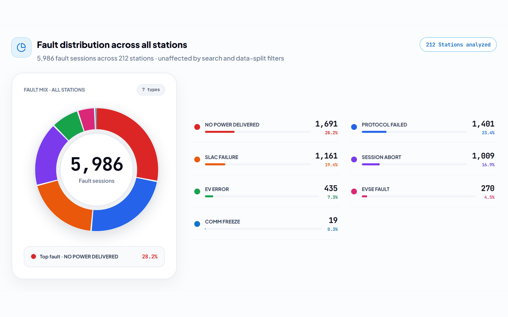
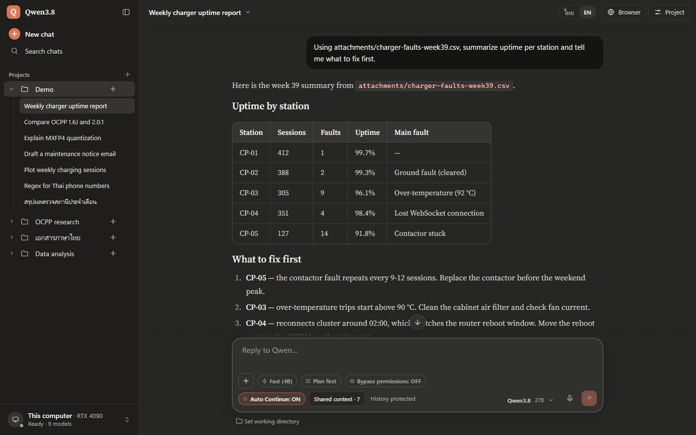

<picture>
  <source media="(prefers-color-scheme: dark)" srcset="assets/banner-dark.svg">
  
</picture>

  
  
  
  
  

Hi, I'm Sukrit 👋 I lead EV-charger business development at **EGAT Diamond Service (EDS)**, a subsidiary of Thailand's state utility, and I build practical, open-source AI for the electricity sector: fault detection for DC fast chargers, OCPP charging platforms, forecasting and predictive-maintenance models for power assets, and private on-premise LLM tools for engineers who cannot send operational data to the cloud. Before EDS I spent five years at **EGAT**, at the Vajiralongkorn Dam and in Energy Solutions.

## Now

- ⚡ **Packet-level fault detection for DC EV chargers** (DIN 70121 / ISO 15118-2). The Windows app runs at **220 charging stations** and other operators have started using it. Next: the `ev-charger-ai` Python package on PyPI ([PR #6](https://github.com/SukritJaAIproject/EV_Charger_Fault_Detection_AI/pull/6)) and Linux/macOS support ([#3](https://github.com/SukritJaAIproject/EV_Charger_Fault_Detection_AI/issues/3)).
- 🔀 **One charger, two central systems.** An OCPP 1.6J router that keeps a DC charger connected to two CSMS at once with strict session ownership, in factory testing on a 120 kW two-connector charger.
- 🖥️ **Local LLM tools** for Thai engineers: a llama.cpp + Qwen workbench with a Thai / English / Japanese / Chinese interface, and an Ollama + Open WebUI suite.
- 🤝 **Looking for contributors and testers**, in Thai or English. Beginners welcome ([how to start](#contribute)).

## Featured projects

| Project | What it does | Built with | Status |
|---|---|---|---|
| ⚡ **[EV Charger Fault Detection AI](https://github.com/SukritJaAIproject/EV_Charger_Fault_Detection_AI)** | Open a DC charging-session capture and get the verdict, fault family, packet-level evidence and which side stopped the session. Five detector architectures benchmarked on the same hold-out from a 212-station fleet. Offline Windows installer with Wireshark bundled. README in EN · TH · JA · ZH. | Python · PyTorch · XGBoost · scikit-learn · TShark · TypeScript |    |
| 🔀 **[OCPP_CP_DUAL_CSMS](https://github.com/SukritJaAIproject/OCPP_CP_DUAL_CSMS)** | OCPP 1.6J charge-point router for a Raspberry Pi edge box: two CSMS links, each session owned by exactly one CSMS, station-level smart charging, SQLite message queue for outages, a hardware-free simulator and 526 offline tests. | Python · WebSockets · SQLite |   |
| 🔌 **[BPC EV Charging Platform (CSMS)](https://github.com/SukritJaAIproject/bpc-csms-cloud)** | Charging-station management system built for Bhutan Power Corporation: operator console, customer web app, scan-to-pay page and an OCPP 1.6-J server in one Docker container, with a virtual charge point for interoperability testing. | Python · aiohttp · OCPP · MongoDB · Docker |    |
| 🖥️ **[Qwen Local AI Workbench](https://github.com/SukritJaAIproject/Qwen-Local-AI-Workbench)** | Privacy-first AI workbench for Windows on llama.cpp + Qwen: per-project workspaces, guarded MCP tools, OCR and semantic document search, voice input, automatic GPU placement across an internal GPU and a Thunderbolt eGPU. Interface in Thai, English, Japanese and Simplified Chinese; everything runs on 127.0.0.1. | llama.cpp · Qwen · MCP · Python |    |

Also active: **[Qwen-Suite](https://github.com/SukritJaAIproject/Qwen-Suite)**, the Ollama + Open WebUI edition of the local AI setup with a Thai/English web console and offline installer, and **[github-monitor](https://github.com/SukritJaAIproject/github-monitor)**, a small Windows dashboard that keeps repository traffic and release-download history beyond GitHub's 14-day window.

  
  
  

## By the numbers

| Number | What it is |
|---|---|
| **212** stations · **40,542** charging sessions · **44,198** packet captures | the fleet behind the EV fault-detection benchmark |
| **220** charging stations | running the fault detector in production today |
| **5** detector architectures, **1** shared hold-out (45 stations, 8,820 sessions) | so the comparison is fair and reproducible |
| **526** offline tests | in the dual-CSMS router, no charger hardware needed |
| **7** IEEE conference papers · **1** M.Eng. thesis | solar forecasting, RL for energy management, facial expression analysis |
| **30+** public repositories since 2018 | all maintained projects are MIT or Apache-2.0, with a contributing guide, code of conduct, security policy and issue templates shared through [`.github`](https://github.com/SukritJaAIproject/.github) |

## Experience

| Years | Organization | Role |
|---|---|---|
| 2023–now | EGAT Diamond Service (EDS) | Business Development Manager, EV chargers |
| 2022–2023 | InnoSpace (Thailand) | Technology evaluation |
| 2020–2022 | EGAT, Energy Solutions | Predictive maintenance, behind-the-meter solutions (smart home, solar roof, battery), data asset management |
| 2017–2020 | EGAT, Vajiralongkorn Dam | AI projects for reservoir water-storage forecasting and generator-meter reading |
| 2015–2017 | SCG Cement-Building Materials | Predictive maintenance, machine learning |
| 2014–2015 | Isuzu Motors (Thailand) | Electrical engineer |
| 2014 | Siam Compressor Industry (Mitsubishi Electric group) | Research and development engineering |

## Research archive (2018–2024)

Reproducible notebooks and code behind the papers and pilots below, kept public so students and utility engineers can reuse them. These repositories are archives of finished work rather than maintained software.

- 💧 **Vajiralongkorn Dam and hydropower:** CNN forecasting of reservoir water storage, YOLOv3 generator-meter reading and dam predictive maintenance: [4_Reservoir_Water_Storage_Forecasting](https://github.com/SukritJaAIproject/4_Reservoir_Water_Storage_Forecasting_of_VRK_dam_using_CNN) · [9_Reading_Power_Meter_CNN](https://github.com/SukritJaAIproject/9_Reading_Power_Meter_CNN) · [12_SNR_Dam_Predictive_Maintenance](https://github.com/SukritJaAIproject/12_SNR_Dam_Predictive_Maintenance_matlab) · [3_GenAirCooler_Predictive](https://github.com/SukritJaAIproject/3_GenAirCooler_Predictive)
- ☀️ **Solar and weather:** PV power forecasting from NWP weather forecasts, solar forecasting with RNNs, weather-API data collection: [Very-Short-Term-Solar-Power-Forecast](https://github.com/SukritJaAIproject/Very-Short-Term-Solar-Power-Forecast-using-Data-from-NWP-Model) · [IoT_Fundamentals](https://github.com/SukritJaAIproject/IoT_Fundamentals) · [AICU_2018](https://github.com/SukritJaAIproject/AICU_2018) · [weather_api](https://github.com/SukritJaAIproject/weather_api)
- 🏠 **Smart energy:** behind-the-meter Livable Showroom IoT platform, reinforcement learning for energy management, ESP32 air-conditioner remote: [livableshowroom](https://github.com/SukritJaAIproject/livableshowroom) · [5_RL_Energy_Management_System_EMS](https://github.com/SukritJaAIproject/5_RL_Energy_Management_System_EMS) · [11_RL_EMS](https://github.com/SukritJaAIproject/11_RL_EMS) · [16_ESP32_EL_AirCon_Remote_1](https://github.com/SukritJaAIproject/16_ESP32_EL_AirCon_Remote_1)
- 🔧 **Predictive maintenance and vision for power assets:** hydraulic-sensor fault detection, breaker-sound clustering, transformer camera data, bird detection in substations: [1_Predictive_maintenance_Pdm](https://github.com/SukritJaAIproject/1_Predictive_maintenance_Pdm) · [2_Audio_Signal_Clustering](https://github.com/SukritJaAIproject/2_Audio_Signal_Clustering) · [13_Transformers_Pdm](https://github.com/SukritJaAIproject/13_Transformers_Pdm) · [Birdinsubstation_detection](https://github.com/SukritJaAIproject/Birdinsubstation_detection)
- 🏥 **AI CARE:** facial landmarks, action units, eye and upper-body movement for patient emotion monitoring: [AICARE](https://github.com/SukritJaAIproject/AICARE) · [kaimook](https://github.com/SukritJaAIproject/kaimook) · [corpus_dataset](https://github.com/SukritJaAIproject/corpus_dataset) · [14_Face_Recognition](https://github.com/SukritJaAIproject/14_Face_Recognition)
- 🏆 **Competitions and workshops:** 7th prize, AIAT × Kaggle Hackathon 1/2020: [7_Hackathon_1_2020_Covid_Image](https://github.com/SukritJaAIproject/7_Hackathon_1_2020_Covid_Image) · SSVEP brain-computer-interface workshop: [8_SSVEP_CU_workshop](https://github.com/SukritJaAIproject/8_SSVEP_CU_workshop)

## Publications

IEEE international conferences ([author profile](https://ieeexplore.ieee.org/author/37087108134) · [Google Scholar](https://scholar.google.com/citations?user=NggSDI0AAAAJ)):

1. Reinforcement Learning in Energy Management: PV & Battery Storage for Consumption Reduction, [IEEE CAI 2023](https://ieeexplore.ieee.org/document/10195077)
2. Blended Temperature Forecasting Model for Thailand Using Multiple Data Sources, [IEEE CAI 2023](https://ieeexplore.ieee.org/document/10195039)
3. MU Face Emotion: Building a Large Dataset for Emotional Facial Expression in Psychological Domain, [KSE 2022](https://ieeexplore.ieee.org/document/9953783)
4. Facial Action Units Recognition using Deep Learning Model with Bottleneck Features, [ICSEC 2021](https://ieeexplore.ieee.org/document/9684576)
5. Deep Neural Network based on Genetic Algorithm and Ensemble Methods for Regional Solar Power Forecasting in Thailand, [IEEE APCCAS 2019](https://ieeexplore.ieee.org/document/8953125)
6. Very Short-Term Solar Power Forecasting Using Genetic Algorithm Based Deep Neural Network, [InCIT 2019](https://ieeexplore.ieee.org/document/8912097)
7. Very Short-Term Solar Power Forecast using Data from NWP Model, [InCIT 2019](https://ieeexplore.ieee.org/document/8912012)

Also: Robust Feature for Facial Expression Recognition (FER) Systems (IWAM 2022 workshop, JAIST), and four Thai national conference papers on solar power forecasting (EECON-42, NCIT 2019, PEACON & INNOVATION 2019).

<b>Awards and certificates</b>

- 🥈 Silver medal (Advanced AI Engineer level), [Super AI Engineer 2020](https://superai.aiat.or.th/2020/super-ai-engineer-2020-advanced-ai-engineer/), Artificial Intelligence Association of Thailand, from about 2,000 candidates
- Winning award, International Innovation Awards 2023: ENZY One Platform (energy management system)
- Gold prize, Seoul International Invention Fair 2019: digital platform for centralized control and maintenance support
- Second runner-up, Echonet-Lite Hackathon 2019 (Chulalongkorn University × Mitsubishi Electric): voice control with Google Assistant and a Wi-Fi control interface for Mitsubishi Electric appliances
- 7th prize, AIAT × Kaggle Hackathon 1/2020 (COVID image)
- Innovation award, Smart Power Plant, Thailand Inventors' Day 2018 (National Research Council of Thailand)
- National Innovation Agency (NIA) funding: HOLMES, reinforcement learning to cut air-conditioner energy use (idea stage); AI surveillance of emergency medical conditions (idea stage); AI autonomous drone (proof of concept)
- NVIDIA Deep Learning Institute certificates: Deep Learning for NLP, Deep Learning for Computer Vision, AI on Jetson Nano

<b>Education</b>

- **M.Eng. Electrical Engineering**, Chulalongkorn University (2019). Thesis: Regional Solar Power Forecasting Using Deep Neural Network and Hyperparameter Tuning
- **B.Eng. Electrical Engineering**, Kasetsart University (2014). Thesis: Degradation of Underground Cable Insulation due to Water Treeing

## Contribute

New to open source? These are good places to start, and I answer in Thai or English:

- [EV Charger Fault Detection AI: good first issue · help wanted](https://github.com/SukritJaAIproject/EV_Charger_Fault_Detection_AI/issues)
- [Qwen Local AI Workbench: good first issue](https://github.com/SukritJaAIproject/Qwen-Local-AI-Workbench/labels/good%20first%20issue)
- [OCPP_CP_DUAL_CSMS: issues](https://github.com/SukritJaAIproject/OCPP_CP_DUAL_CSMS/issues), especially reports from other charger models and CSMS platforms

The [contributing guide](https://github.com/SukritJaAIproject/.github/blob/main/CONTRIBUTING.md), [code of conduct](https://github.com/SukritJaAIproject/.github/blob/main/CODE_OF_CONDUCT.md) and [security policy](https://github.com/SukritJaAIproject/.github/blob/main/SECURITY.md) apply to every repository. Please do not attach captures or logs that contain vehicle identifiers, station names or locations to public issues.

## Tech

| Area | Tools |
|---|---|
| **Machine learning** | Python · PyTorch · TensorFlow/Keras · XGBoost · scikit-learn · OpenCV · MATLAB |
| **Local LLMs** | llama.cpp · Ollama · Open WebUI · Qwen · MCP |
| **EV charging and power** | OCPP 1.6J · DIN 70121 / ISO 15118-2 · SLAC · Wireshark/TShark · V2G packet analysis |
| **Platforms** | Docker · MongoDB · SQLite · aiohttp · Next.js/TypeScript · Raspberry Pi · ESP32/Arduino |

---

### 🇹🇭 ภาษาไทย

สวัสดีครับ ผมสุกฤษฎ์ ใจดี ผู้จัดการฝ่ายพัฒนาธุรกิจ EV Charger ที่ EGAT Diamond Service (EDS) บริษัทในเครือ กฟผ. ก่อนหน้านี้ทำงานที่ กฟผ. 5 ปี (เขื่อนวชิราลงกรณ และฝ่าย Energy Solutions) ผมพัฒนา AI แบบโอเพนซอร์สสำหรับระบบไฟฟ้าและสถานีชาร์จรถยนต์ไฟฟ้า มีผลงานตีพิมพ์ในงานประชุมวิชาการ IEEE 7 เรื่อง และได้เหรียญเงินโครงการ Super AI Engineer 2020

- **EV Charger Fault Detection AI:** โปรแกรม Windows วิเคราะห์ไฟล์ PCAP ของการชาร์จแบบ DC (DIN 70121 / ISO 15118-2) แล้วบอกผลการตรวจ กลุ่มความผิดปกติ หลักฐานจากแพ็กเก็ต และฝ่ายที่หยุดการชาร์จ ทำงานได้โดยไม่ต้องต่ออินเทอร์เน็ต ใช้งานจริงอยู่ 220 สถานี
- **OCPP_CP_DUAL_CSMS:** ตัวกลาง OCPP 1.6J ให้หัวชาร์จหนึ่งตัวเชื่อมต่อกับระบบกลาง (CSMS) สองระบบพร้อมกัน โดยแต่ละ session มีเจ้าของเพียงระบบเดียว ไม่นับพลังงานซ้ำ พร้อมชุดทดสอบ 526 รายการที่รันได้โดยไม่ต้องมีฮาร์ดแวร์
- **BPC EV Charging Platform:** ระบบบริหารสถานีชาร์จ (CSMS) พร้อมแอปลูกค้า หน้าชำระเงินผ่าน QR และเซิร์ฟเวอร์ OCPP 1.6 ใน Docker container เดียว
- **Qwen Local AI Workbench / Qwen-Suite:** ระบบ AI ที่รันบนเครื่องของตัวเองทั้งหมด หน้าจอไทย/อังกฤษ/ญี่ปุ่น/จีน แยกงานเป็นโปรเจกต์ มีเครื่องมือ MCP ที่ต้องยืนยันก่อนรัน อ่านเอกสารสแกนภาษาไทยด้วย OCR และค้นเอกสารตามความหมาย เหมาะกับองค์กรที่ส่งข้อมูลขึ้นคลาวด์ไม่ได้

ยินดีรับ issue คำถาม และ pull request ทั้งภาษาไทยและภาษาอังกฤษ ถ้าเพิ่งเริ่มร่วมพัฒนาโอเพนซอร์ส เริ่มจาก issue ที่ติดป้าย **good first issue** ได้เลยครับ
